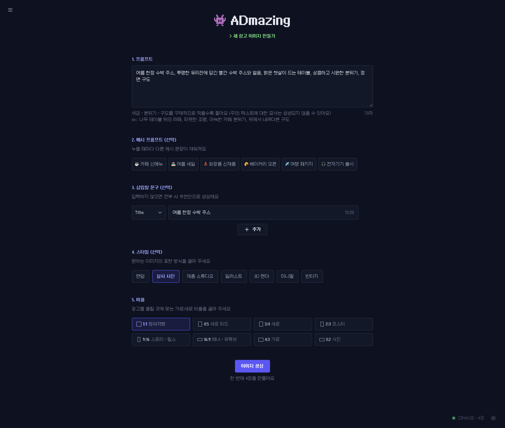
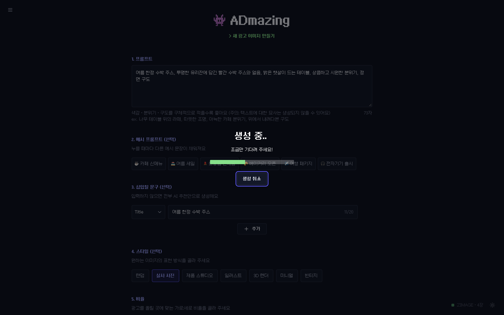
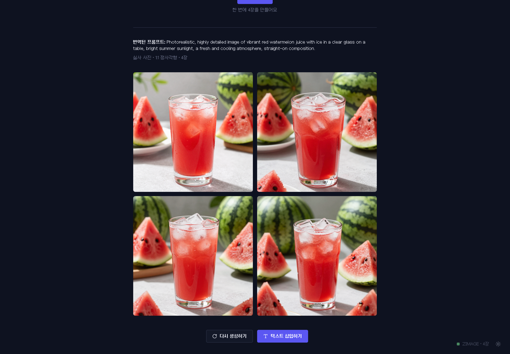
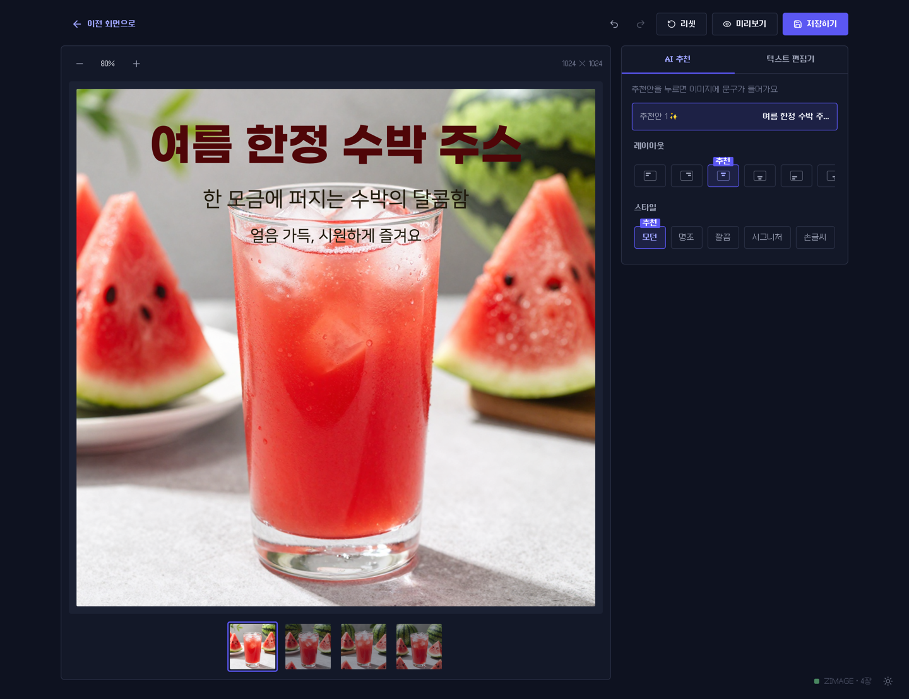

# Admazing

한국어 한 줄로 광고 이미지를 만들고, 그 위에 광고 문구까지 얹어 완성하는 서비스입니다.

| 항목       | 내용       |
|:-----------|:-----------|
| 프로젝트명 | Admazing   |
| 팀 이름    | 끝내주는팀 |

<table>
  <tr>
    <td align="center"></td>
    <td align="center"></td>
    <td align="center"></td>
  </tr>
  <tr>
    <td align="center"><b>👑 최민식</b></td>
    <td align="center"><b>최승원</b></td>
    <td align="center"><b>박예진</b></td>
  </tr>
  <tr>
    <td align="center">PM</td>
    <td align="center">Backend</td>
    <td align="center">Frontend</td>
  </tr>
  <tr>
    <td align="center"><a href="https://app.notion.com/p/41571fde206b80cdb60adaab9ceba579?source=copy_link">개인일지</a></td>
    <td align="center"><a href="https://app.notion.com/p/41571fde206b801f95e5e06ef9c4fd2f?source=copy_link">개인일지</a></td>
    <td align="center"><a href="https://app.notion.com/p/41571fde206b80ccbd71e2cb351e8aea?source=copy_link">개인일지</a></td>
  </tr>
</table>

## 시연

> 프롬프트: `항공사 여행 광고, 에메랄드빛 바다 위로 우뚝 솟은 웅장한 해안 절벽, 파란 하늘을 가로지르는 하얀 여객기, 밝은 햇살과 부서지는 파도, 탁 트이고 설레는 분위기, 넓은 풍경 구도`
> 삽입할 문구(Title): `지금, 바다 너머로`, 스타일: 실사 사진, 비율: 1:1

| 생성 원본 | 문구를 넣은 완성본 |
|:-:|:-:|
|  |  |

| | |
|:-:|:-:|
|  |  |
| **1. 입력**: 프롬프트, 넣고 싶은 문구, 스타일, 비율을 고릅니다 | **2. 생성**: 진행률을 보며 기다리고, 도중에 취소할 수 있습니다 |
|  |  |
| **3. 결과**: 영어로 바꾼 프롬프트와 함께 4장을 한 번에 만듭니다 | **4. 에디터**: AI 추천 문구와 배치를 적용하고 글꼴, 효과를 다듬어 PNG로 저장합니다 |

## 주요 기능

- **광고 이미지 생성**: 한국어 프롬프트를 OpenAI로 영어로 바꾼 뒤 Z-Image-Turbo(또는 SDXL)로 한 번에 여러 장을 생성합니다. 스타일과 비율(1:1, 4:5, 9:16, 16:9 등)을 고를 수 있습니다.
- **진행률과 취소**: 생성 작업을 SSE로 받아 단계별 진행률을 보여 주고, 도중에 취소할 수 있습니다.
- **광고 문구 추천**: 생성된 이미지마다 제목, 부제, 본문 문구 후보와 강조색을 추천합니다. 역할별로 넣고 싶은 내용을 적으면 AI가 참고해 문구를 씁니다 (가격, 날짜, 숫자는 그대로 유지).
- **문구 배치 추천**: 광고 레이아웃 템플릿과 제품, 얼굴 영역 검출로 문구 위치, 글꼴, 색 추천안을 만듭니다.
- **텍스트 에디터**: 문구 상자를 넣고 글꼴(광고용 30종), 크기, 색, 외곽선, 그림자, 배경 상자, 회전, 곡선을 조절합니다. 되돌리기, 복사, 붙여넣기, 맞춤 가이드, 여러 개 선택을 지원하며 결과를 PNG로 저장합니다.

## 구조

```
admazing/
├── backend/
│   ├── fastapi/     # API 서버 (:11000) — 번역, 이미지 생성, 문구, 배치 추천
│   └── ai/          # 모델 준비, 학습 코드 (서버 아님) → 산출물을 models/에 저장
├── frontend/        # React + Vite + TypeScript (:12000)
├── fonts/           # 광고 문구용 폰트 목록(manifest.json)과 직접 받은 폰트
├── scripts/         # 폰트 준비 스크립트 (font-prep 서비스)
├── models/          # 모델 가중치, 학습 산출물 (git 제외)
├── docs/            # 작업 규칙과 문구 상자 JSON 형식 문서
├── docker-compose.yml
└── docker-compose.gpu.yml   # NVIDIA GPU 환경용 override
```

파트별 자세한 내용은 각 README를 참고하세요.

- [backend/fastapi/README.md](backend/fastapi/README.md) — API 엔드포인트, 서비스 구성, 설정
- [frontend/README.md](frontend/README.md) — 화면 구성, 폴더 구조, 개발 명령
- [backend/ai/README.md](backend/ai/README.md) — 모델 준비, 학습

## 요청 흐름

```
frontend ──POST /api/jobs──▶ api ──OpenAI──▶ 영어 프롬프트
   ▲                          │
   │                          ├── ImageGenerator(mock | diffusers | sdxl | zimage) ──▶ 이미지 N장
   │                          │
   │                          └── CopyRecommender(openai | mock) ──▶ 이미지별 추천 문구
   │
   └──GET /api/jobs/{id}/events (SSE: 진행률 → 결과)

editor ──POST /api/layout/recommend──▶ api ──템플릿 + 영역 검출──▶ 문구 배치 추천안
```

## 실행

```bash
cp .env.example .env   # OPENAI_API_KEY 입력
docker compose up --build
```

- Frontend: http://localhost:12000
- API 문서: http://localhost:11000/docs

`docker compose up` 시 아래 순서로 실행됩니다.

| 서비스       | 역할                                                                      |
|:-------------|:--------------------------------------------------------------------------|
| `model-prep` | `ZIMAGE_QUANT` 양자화 모델이 없으면 원본에서 변환 (필요 없으면 바로 종료) |
| `api`        | FastAPI 서버. `model-prep`이 끝난 뒤 시작                                 |
| `font-prep`  | `fonts/manifest.json`의 폰트를 받아 woff2로 준비                          |
| `frontend`   | Vite 개발 서버. `font-prep`이 끝난 뒤 시작                                |
| `trainer`    | 학습용. `--profile train`으로 필요할 때만 실행                            |

### 이미지 생성 모드

| 모드        | `.env` 설정                                    | 용도                                            |
|:------------|:-----------------------------------------------|:------------------------------------------------|
| mock (기본) | `IMAGE_GENERATOR=mock`, `INSTALL_ML=false`     | 프론트/백엔드 개발. torch 없이 더미 이미지 반환 |
| zimage      | `IMAGE_GENERATOR=zimage`, `INSTALL_ML=true`    | Z-Image-Turbo로 생성 (시연, 배포)               |
| sdxl        | `IMAGE_GENERATOR=sdxl`, `INSTALL_ML=true`      | SDXL 기본 모델 + fp16 VAE로 생성                |
| diffusers   | `IMAGE_GENERATOR=diffusers`, `INSTALL_ML=true` | `MODEL_PATH`의 모델(+`LORA_PATH`)로 생성        |

실제 모델 모드에서는 코드 변경으로 서버가 재시작될 때마다 모델을 다시 불러옵니다.

```bash
# NVIDIA GPU 서버
docker compose -f docker-compose.yml -f docker-compose.gpu.yml up --build
```

GPU 서버에서는 `.env`에 아래 줄을 넣어 두면 `-f` 없이 `docker compose up --build`만 해도 GPU 설정이 포함됩니다. 빠뜨리면 api 컨테이너가 GPU를 보지 못해 CPU로 생성하려다 램 부족으로 종료될 수 있습니다.

```bash
COMPOSE_FILE=docker-compose.yml:docker-compose.gpu.yml
SDXL_DEVICE=cuda      # GPU를 못 잡으면 CPU로 넘어가지 않고 바로 에러
ZIMAGE_DEVICE=cuda
```

컨테이너가 GPU를 보는지 확인:

```bash
docker compose exec api python -c "import torch; print(torch.cuda.is_available())"
```

#### Z-Image 양자화 (선택)

GPU 서버에서 `.env`에 `ZIMAGE_QUANT=fp8`(또는 `int8`)을 넣으면 transformer, text_encoder 가중치를 8bit로 줄여 올립니다. `fp8`은 SM 8.9 이상 GPU(L4 등)에서만 동작합니다.

`model-prep` 서비스가 `models/z-image-turbo-<종류>/`가 없으면 `models/z-image-turbo/`에서 변환해 저장합니다. 첫 실행에만 변환 시간이 걸리고, torch, torchao, diffusers, transformers 버전이 바뀌면 다시 변환합니다.

```bash
docker compose logs model-prep     # 변환 진행 상황 확인
```

### 문구 추천과 배치 추천

- 문구 추천은 OpenAI에 이미지와 프롬프트를 보내 만듭니다. OpenAI 없이 개발하려면 `COPY_RECOMMENDER=mock`으로 둡니다.
- 문구 배치 추천은 CPU에서 템플릿과 규칙으로 만들며, 제품, 얼굴을 가리지 않도록 검출 모델을 씁니다. 모델 파일을 `models/detectors/`에 받아 둡니다 (받는 명령은 `.env.example` 참고). 파일이 없는 개발 환경에서는 `LAYOUT_DETECT_SUBJECTS=0`으로 둡니다.

### 광고 문구 폰트

`font-prep` 서비스가 [fonts/manifest.json](fonts/manifest.json)의 폰트를 받아 woff2로 준비합니다. 폰트 파일은 git에 올리지 않고 Docker 볼륨(`font-files`)에 두며, frontend에서 `/fonts/...` 경로로 제공됩니다. 첫 실행에만 받는 시간이 걸리고, 받기에 실패해도 frontend는 뜹니다(해당 폰트만 기본 글꼴로 표시).

```bash
docker compose logs font-prep      # 준비 결과 확인
```

- 웹폰트 주소가 없는 폰트는 manifest에 `manual`로 적고, 배포처에서 직접 받아 `fonts/manual/<id>/`에 넣습니다.
- 폰트를 추가, 변경하면 manifest를 고친 뒤 로컬에서 `python scripts/prepare_fonts.py`를 실행해 `frontend/src/styles/fonts.css`(@font-face)와 `frontend/src/constants/fonts.json`(화면용 폰트 목록)을 갱신하고 커밋합니다 (`pip install -r scripts/requirements.txt` 필요).

### 학습한 모델 사용

학습 산출물을 `models/<name>/`에 두고 `.env`에서 경로를 지정합니다. (컨테이너에는 `/models`로 마운트됨)

```bash
IMAGE_GENERATOR=diffusers
MODEL_PATH=/models/ad-v1         # 전체 모델
LORA_PATH=/models/ad-lora-v1     # 또는 기본 모델 + LoRA
```

산출물 형식과 학습 실행 방법은 [backend/ai/README.md](backend/ai/README.md)를 참고하세요.

## 개발 규칙

- 코드 작성: [docs/project_code_rule.md](docs/project_code_rule.md)
- 커밋 메시지: [docs/git_commit_rule.md](docs/git_commit_rule.md)
- 브랜치 / PR: [docs/git_branch_rule.md](docs/git_branch_rule.md)
- 포맷팅: backend는 `black backend`, frontend는 `cd frontend && npm run format`
